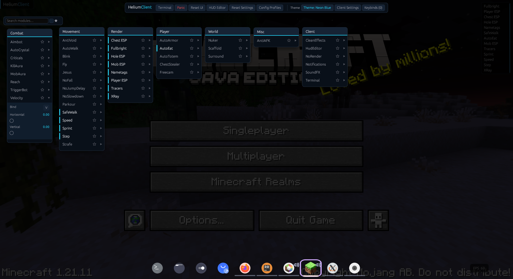
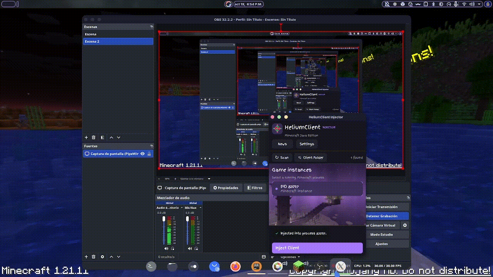

# HeliumClient

[](https://github.com/26140070-cpu/Helium-Client)
[](https://discord.gg/G6CwQHBJF6)

[](https://github.com/26140070-cpu/Helium-Client/stargazers)
[](https://github.com/26140070-cpu/Helium-Client/blob/master/LICENSE)
[](https://www.rust-lang.org/)
[](https://discord.gg/G6CwQHBJF6)

HeliumClient is a native Minecraft Java Edition client framework written in Rust. It injects a small native agent into a running JVM, loads the client library, and uses JNI to interact with the game. The workspace includes an injector with GUI, TUI, and command-line modes, an agent loader, and the in-game client.



*In-game ClickGUI and module settings.*



*Client initialization in Minecraft.*

## Features

- **Injector:** discover Minecraft processes and inject from a responsive GUI, a terminal UI (`--tui`), or headless CLI modes (`--list`, `--inject <pid>`).
- **Hot reload:** send reload commands to the injected agent over a localhost TCP connection, without restarting Minecraft.
- **ClickGUI and HUD:** toggle modules, change settings and keybinds, manage profiles, and customize the overlay.
- **Module framework:** combat, movement, player, render, world, and client modules.
- **Friends:** add or remove the player under the crosshair with middle-click; friend data is persisted separately.
- **Config profiles:** save, load, list, and remove named module configurations.
- **Packet handling:** a Netty pipeline bridge lets supported modules inspect, modify, or cancel selected packets.
- **In-game terminal:** inspect logs and use built-in commands for modules, profiles, keybinds, themes, and the sandboxed filesystem.
- **Persistent settings:** module settings, enabled states, keybinds, GUI layout, and appearance are saved between injections.

The module list includes Fly, Blink, NoFall, KillAura, AutoEat, AutoTotem, Surround, Hole ESP, XRay ore markers, player/mob/chest ESP, Tracers, Nametags, and others. Feature availability depends on Minecraft version and game context. **XRay currently marks nearby ores through walls; it does not make ordinary blocks transparent. PacketFly is not implemented.** Test gameplay modules in a suitable single-player world or server and follow that server's rules.

## Compatibility

| Area | Status |
| --- | --- |
| Windows | Injector and client build supported; injector must run as Administrator. |
| Linux | Injector and client build supported; injection requires root/ptrace permission. A downloadable AppImage is provided. |
| macOS | x86_64 only (Intel or x86_64 JVM under Rosetta). Uses HotSpot `jcmd` dynamic attach and hooks GLFW's buffer swap. Distributed as a zipped `.app` bundle; not yet tested on a macOS host. |
| Minecraft 26.1+ | Runtime reflection mapping; JDK 25 is required by Minecraft 26.1. The README's latest tested version is 26.1.2. |
| Obfuscated Minecraft | Uses bundled Mojang mappings for 1.21.11. For other versions, regenerate mappings with `conversion.py`; older versions are not individually verified. |
| Fabric / Forge / NeoForge | Supported with unobfuscated Minecraft builds (26.1+). Obfuscated mod-loader mappings such as intermediary/SRG are not supported. |

These compatibility notes describe the mapping and platform paths in the code; they are not a guarantee that every module has been validated in-game on every combination.

## Requirements

- Rust and Cargo. Use the stable toolchain on Linux; Windows builds use the **nightly** toolchain.
- JDK 21 or newer for building/testing the supported pre-26.1 versions. On Windows, make sure `JAVA_HOME` points to a JDK with `jvm.lib`, or set `JVM_LIB_DIR` to the directory containing that file.
- Minecraft Java Edition running on the same machine.
- Linux: permission to trace/inject into the Minecraft process (normally run the injector with `sudo`).
- Windows: run the injector as Administrator.
- macOS: use an x86_64 JDK/JVM with `jcmd` available (set `JAVA_HOME` if needed); attach must be enabled by the JVM. The injector must run as the same user as Minecraft.

For Minecraft 26.1, install JDK 25 to run the game. The CI build currently uses JDK 21 for its Windows/Linux build matrix.

## Build from source

Clone the repository and build the optimized workspace artifacts:

```bash
git clone https://github.com/TheDarkSword/HeliumClient.git
cd HeliumClient
cargo build --release
```

The build produces the injector and two native libraries in `target/release/`:

| Platform | Injector | Agent loader | Client |
| --- | --- | --- | --- |
| Linux | `injector` | `libagent_loader.so` | `libclient.so` |
| Windows | `injector.exe` | `agent_loader.dll` | `client.dll` |
| macOS x86_64 | `injector` | `libagent_loader.dylib` | `libclient.dylib` |

**Keep the injector and both libraries together.** Start the injector with that directory as its working directory; this is also where logs and configuration are stored.

### Linux

```bash
cargo +stable build --release
cd target/release
sudo ./injector
```

If your system restricts `ptrace`, adjust its policy or run the injector with the required privileges. Do not inject into a process you do not own or have permission to modify.

### Windows

Install the Rust nightly toolchain and a JDK that includes `jvm.lib`, then build:

```powershell
rustup toolchain install nightly
cargo +nightly build --release
cd target\release
```

Run `injector.exe` as Administrator from this directory. If the build cannot find `jvm.lib`, set `JAVA_HOME` to the JDK root or `JVM_LIB_DIR` to the folder containing the import library.

### macOS (Intel or Rosetta x86_64)

Build on an Intel Mac, or cross-build the x86_64 target on macOS:

```bash
rustup target add x86_64-apple-darwin
cargo build --release --target x86_64-apple-darwin
```

The cross-build needs Apple's macOS SDK and a compatible C toolchain. Run an x86_64 Minecraft JVM and launch `injector` as the same user. Ensure `jcmd` belongs to the same JDK as the game (`JAVA_HOME` can point to that JDK); the injector uses `JVMTI.agent_load` to attach `libagent_loader.dylib`. JVMs started with dynamic attach disabled cannot be injected. Apple Silicon-native ARM64 JVMs are not supported because the current frame hook is x86_64-only.

The workspace also provides these useful development commands:

```bash
cargo check --workspace
cargo test --workspace
cargo fmt --all
cargo clippy --workspace
```

T2 integration tests start an in-process JVM and require a JDK. The end-to-end harness (`cargo xtask e2e`) needs Minecraft running and the platform's injection permissions.

## Downloading release builds

Open [Releases](https://github.com/26140070-cpu/Helium-Client/releases/latest) and download the package for your system:

- **Windows:** download `injector.exe`, `agent_loader.dll`, and `client.dll` into the same folder.
- **Linux:** download `HeliumClient-x86_64.AppImage`, make it executable in the file manager's permissions, and launch it. If needed, `chmod +x HeliumClient-x86_64.AppImage` grants execute permission. If your system lacks AppImage/FUSE support, launch it with `--appimage-extract-and-run`. Minecraft process access may require elevated permissions. The raw `injector`, `libagent_loader.so`, and `libclient.so` files are also available.
- **macOS Intel / Rosetta:** download and unzip `HeliumClient-macOS-x86_64.zip`, then move `HeliumClient.app` into Applications. It requires an x86_64 Minecraft JVM; Apple Silicon-native ARM64 JVMs are not supported yet.

The macOS app is not notarized, so Gatekeeper may show a first-launch security warning. If that happens, use Finder's **Open** action from the app's context menu and confirm the prompt. The Linux AppImage requires a compatible x86_64 Linux system.
These packages are attached to releases built with the updated release workflow; older releases do not include the AppImage or macOS app bundle.

## Run

1. Build the workspace and keep the injector and native libraries in the same directory.
2. Start Minecraft Java Edition and wait until it reaches the title screen.
3. Launch the injector from the directory containing the libraries: `sudo ./injector` on Linux, run `injector.exe` as Administrator on Windows, or run `./injector` as the same user as Minecraft on macOS.
4. In the GUI, scan for Minecraft, select the process, and choose **Inject**. Alternatively, use the CLI:

   ```bash
   ./injector --list
   sudo ./injector --inject <pid>
   ```

   On Windows, run the command prompt as Administrator and omit `sudo`. On macOS, make sure the matching JDK's `jcmd` is available on `PATH` or set `JAVA_HOME`.

5. Once injected, open a world. The client can initialize at the title screen, but world-dependent modules remain inactive until there is a living player in a world.

The ClickGUI opens with **Right Shift** by default. **Escape** closes it. Use the GUI's keybind controls to change the key. The standalone injector also supports `./injector --tui`.

## How it works

1. The injector finds the Minecraft JVM and loads `agent_loader` into it: ptrace-based injection on Linux, DLL injection on Windows, or HotSpot dynamic attach via `jcmd` on macOS.
2. The agent loader starts a localhost command server (`127.0.0.1:7878`).
3. The injector sends a reload command containing the client library path and configuration directory.
4. The agent loader loads `client`, calls `initialize_client`, and supports subsequent reloads without restarting the game.
5. The client discovers the JVM/game class loader, initializes mappings and module state, loads configuration, and installs its render/input hooks.
6. The render hook draws the egui overlay and checks for new game ticks. Enabled modules run only while the player is alive in a world.

For obfuscated Minecraft, class/member names come from the bundled Mojang mappings. For unobfuscated builds, names are resolved directly and method signatures are discovered through Java reflection. The packet bridge is defined into the active game class loader and inserted into the Netty connection pipeline.

The client library exports `initialize_client` and `cleanup_client`. A panic triggers cleanup of the render/input hooks before the library is unloaded.

## Configuration and logs

Files are written to the injector's **working directory**, not `.minecraft`:

- `app.log` — injector log
- `agent_loader.log` — agent loader log
- `helium_client.log` — client log
- `helium_client_config.json` — module settings, keybinds, enabled states, GUI layout, and appearance
- `helium_client_friends.json` — friends list
- `profiles/` — named configuration profiles

Run the injector from a stable directory so these files remain together and are easy to find.

## Mapping generation

The checked-in `mappings.json` is a Mojang mapping snapshot. To generate mappings for an older obfuscated Minecraft version, install Python and `requests`, choose the target version in `conversion.py`, and run:

```bash
python conversion.py
```

The unobfuscated 26.1+ reflection path does not use `mappings.json`.

## License

See [LICENSE](LICENSE) for the project license. Minecraft is a trademark of Microsoft/Mojang; this project is unofficial and is not affiliated with or endorsed by them.
